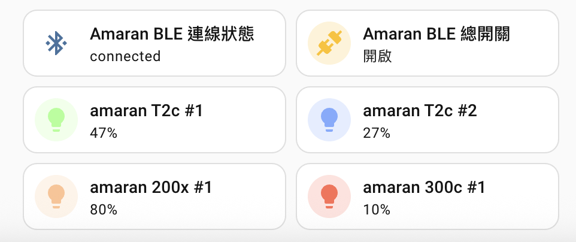

# Amaran BLE for Home Assistant

[](https://github.com/Minwei21144/ha-amaran-ble/releases)
[](https://github.com/Minwei21144/ha-amaran-ble/actions/workflows/validate.yml)
[](https://github.com/Minwei21144/ha-amaran-ble/actions/workflows/tests.yml)
[](LICENSE)

An unofficial Home Assistant custom integration for locally controlling an
existing Amaran/Sidus BLE Mesh through Home Assistant Bluetooth or an ESPHome
Bluetooth Proxy.

> **Source beta:** `main` contains `0.5.0-beta.107`, which fixes a permanent
> stale-slot recovery wait after an ESPHome scanner replacement. The latest
> tagged HACS release remains `v0.5.0-beta.106`. Both import an existing Sidus
> Mesh; they do not provision a new fixture or create a new Mesh.

[繁體中文文檔](README.zh-TW.md)

[beta.107 changes and validation](docs/RELEASE-v0.5.0-beta.107.md) |
[v0.5.0-beta.106 release notes](docs/RELEASE-v0.5.0-beta.106.md) |
[Changelog](CHANGELOG.md)

GATT/CCCD reconnection retries can still take several minutes. This update
addresses stale slot tracking, not a guaranteed connection-time limit.



## Features

- Local BLE Mesh control without a permanently running Windows PC or cloud API.
- Power and standard Home Assistant light controls according to each fixture's
  declared capabilities.
- Dedicated brightness, 100 K CCT, G/M, hue and saturation numeric controls.
- Multiple fixtures and dynamic Mesh Proxy candidates; fixture MAC addresses
  are never hard-coded.
- A control switch that acquires and keeps one Mesh Proxy connection while on,
  then releases it for Sidus Link or Amaran Desktop when turned off.
- Proxy failover when the active fixture disconnects.
- Topology-aware recovery when only part of the imported Mesh is powered, plus
  bounded ESPHome GATT-slot release handling before reconnecting.
- Periodic state refresh, Mesh status notifications and conservative
  availability tracking.
- Diagnostics that redact Mesh keys and consistently pseudonymize MAC
  addresses.

## Validated hardware

| Fixture | CCT | HS color | G/M metadata |
| --- | --- | --- | --- |
| amaran T2c | 2500-7500 K | Yes | Yes |
| amaran 200x | 2700-6500 K | No | No |
| amaran 300c | 2500-7500 K | Yes | Yes |

The current hardware validation used one Sidus Mesh with two T2c fixtures, one
200x and one 300c, connected through an ESPHome Bluetooth Proxy. Other
Amaran/Aputure fixtures may work but are not yet verified.

## Requirements

- Home Assistant `2026.7.0` or newer.
- Working Home Assistant Bluetooth or an ESPHome Bluetooth Proxy with active
  connections enabled.
- Fixtures already added to the same Mesh in Amaran Desktop or Sidus Link.
- The Mesh NetKey, AppKey and fixture addresses exported from Amaran Desktop.
- Amaran Desktop and Sidus Link closed while Home Assistant owns the Mesh
  connection.

## Install with HACS

This beta is distributed as a HACS Custom Repository and is not yet included in
the default HACS catalog.

1. Open HACS and select **Integrations**.
2. Open the menu and select **Custom repositories**.
3. Enter `https://github.com/Minwei21144/ha-amaran-ble`.
4. Select the **Integration** category and add the repository.
5. Download **Amaran BLE** and select `v0.5.0-beta.106`. If pre-releases are
   hidden, enable beta versions for this HACS repository first.
6. Restart Home Assistant.

The beta.107 source fix is not included in the beta.106 HACS release. Use the
manual installation below from `main` to test it before a new release is tagged.

[](https://my.home-assistant.io/redirect/hacs_repository/?owner=Minwei21144&repository=ha-amaran-ble&category=integration)

Manual installation is also possible by copying
`custom_components/amaran_ble` to
`/config/custom_components/amaran_ble` and restarting Home Assistant.

## Export an existing Mesh

Run the exporter on the Windows computer where Amaran Desktop is installed:

```powershell
.\amaran_export_ha_config.cmd
```

Or run the PowerShell script directly:

```powershell
powershell -NoProfile -ExecutionPolicy Bypass -File .\amaran_export_ha_config.ps1
```

Python is required. The exporter reads Amaran Desktop's local database and
fixture capability file, writes `amaran-ble-ha-config.json`, and prints the full
JSON in the terminal so it can be reviewed and copied.

The JSON contains private Mesh keys. Do not post it in an issue, log, screenshot
or diagnostic attachment.

Example with non-real addresses and keys:

```json
{
  "net_key": "00112233445566778899AABBCCDDEEFF",
  "app_key": "FFEEDDCCBBAA99887766554433221100",
  "relay_hub": "02:00:00:00:00:01",
  "lights": [
    {
      "name": "amaran T2c #1",
      "mac": "02:00:00:00:00:01",
      "mesh_address": 3,
      "min_kelvin": 2500,
      "max_kelvin": 7500,
      "supports_hs": true,
      "supports_gm": true
    },
    {
      "name": "amaran 200x #1",
      "mac": "02:00:00:00:00:02",
      "mesh_address": 4,
      "min_kelvin": 2700,
      "max_kelvin": 6500,
      "supports_hs": false,
      "supports_gm": false
    }
  ]
}
```

## Configure Home Assistant

1. Go to **Settings > Devices & services**.
2. Select **Add integration** and search for **Amaran BLE**.
3. Paste the complete exported JSON.
4. Finish setup and open the new **Amaran BLE Control** device.
5. Turn on its control switch to let Home Assistant acquire a Mesh Proxy.
6. Wait until the connection sensor reports `connected`, then control the
   fixture entities.

Turning the control switch off disconnects Home Assistant so official Amaran
applications can reconnect.

## Numeric controls

The integration keeps the standard Home Assistant light entity and adds
fixture-specific number entities:

- **Brightness:** `0.1%` to `100.0%` in `0.1%` steps for every fixture. It uses
  the independent Mesh brightness command and does not switch CCT/HSI mode.
- **Color temperature:** the imported fixture range in fixed `100 K` steps.
- **G/M:** `-10` to `+10` when `supports_gm` is enabled.
- **Hue:** `0` to `360 degrees` and **Saturation:** `0%` to `100%` when
  `supports_hs` is enabled.

Changing one numeric channel preserves its companion channels. The standard
Home Assistant device page sorts these controls by localized display name; it
does not preserve the integration's entity creation order.

## Connection lifecycle

- `released`: Home Assistant is not holding a Mesh connection.
- `connecting`: candidates are being scanned and attempted.
- `stabilizing`: Mesh login succeeded and the 30-second operational window is
  running.
- `connected`: the connection is operational and fixture commands are enabled.
- `unavailable`: no candidate is currently usable.

An operational connection becomes internally trusted after 120 seconds. A
candidate that disconnects during this probation period is quarantined before
it can be selected again. This reduces repeated selection of a fixture that
opens successfully but drops the GATT link shortly afterward.

## Privacy and security

- NetKey and AppKey grant control of the imported Mesh. Treat the exported JSON
  like a password.
- Home Assistant diagnostics recursively redact both Mesh keys.
- MAC addresses in diagnostics, nested candidate maps and error messages are
  replaced with stable aliases such as `**REDACTED_MAC_1**`.
- Test and example data in this public repository use synthetic addresses.
- The integration does not send fixture data to an Amaran cloud service.

See [SECURITY.md](SECURITY.md) before reporting a security issue.

## Known limitations

- New fixture provisioning and creation of a new Sidus Mesh are not supported.
- This is a reverse-engineered, unofficial integration and may stop working
  after fixture, Sidus Link or Amaran Desktop updates.
- First acquisition commonly takes tens of seconds. Candidate failures can make
  it longer because the integration waits for the Bluetooth Proxy to safely
  release its GATT slot.
- A powered-off non-proxy fixture may take roughly 30-60 seconds to become
  unavailable. The delay avoids false offline states caused by normal Mesh
  packet loss.
- The native Home Assistant device page controls entity order. The integration
  cannot force a custom order without visible name prefixes or a custom card.
- Only the models listed above have been tested on physical hardware.
- One-of-four and two-of-four partial-power acquisition have completed the
  current qualification. Three-of-four, four-of-four and extended retention
  stress testing are still pending.
- Brand artwork is intentionally not bundled until trademark-safe assets and a
  Home Assistant Brands submission are available.

## Troubleshooting

Enable debug logging:

```yaml
logger:
  default: info
  logs:
    custom_components.amaran_ble: debug
```

Check these items first:

1. Close Sidus Link and Amaran Desktop.
2. Confirm that the ESPHome Bluetooth Proxy has active connections enabled and
   a free GATT slot.
3. Confirm that at least one imported fixture is powered and advertising.
4. Turn the Amaran BLE control switch off, wait for `released`, then turn it on.
5. Download diagnostics before opening an issue. Diagnostics are sanitized, but
   review them before sharing.
6. If diagnostics show `last_error_hint: bootstrap_gatt_profile_rejected`, the
   fixture uses a different GATT handle layout than the validated T2c. The
   integration retries that fixture with full service discovery automatically;
   please report the fixture model so it can be added to the validated list.

## Development

Run the offline test suite:

```powershell
python -m unittest discover -s tests -v
python -m compileall -q custom_components tests tools
```

Architecture and safety boundaries are documented in
[docs/ARCHITECTURE.md](docs/ARCHITECTURE.md). Contributions are welcome; read
[CONTRIBUTING.md](CONTRIBUTING.md) first.

## License and trademark notice

This project is licensed under the [MIT License](LICENSE).

Amaran, Aputure, Sidus Link and related marks belong to their respective
owners. This community project is not affiliated with, endorsed by or supported
by Amaran or Aputure.
